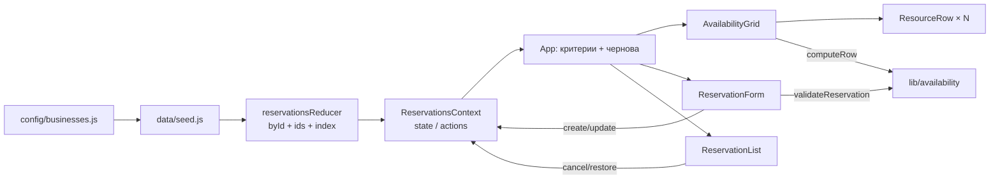

# Универсална система за резервации (React + Vite)

Една система за резервации, която се настройва чрез **конфигурация** за различни видове бизнес. Кодът на логиката и интерфейса е общ, а разликите (ресурси, услуги, работно време, капацитет, стъпка на слотовете) са описани като данни.

Включени са 5 бизнеса със симулирани данни.

---

## 1. Стартиране

Изисква се Node.js.

### От GitHub

```bash
git clone <адрес-на-хранилището>
cd <име-на-папката>
npm install
npm run dev        # отворете http://localhost:5173
```

> **Windows / PowerShell:** ако излезе грешка „running scripts is disabled on this system“, използвайте `npm.cmd install` и `npm.cmd run dev` или изпълнете веднъж `Set-ExecutionPolicy -Scope CurrentUser RemoteSigned`.
>
> Ако `npm` казва, че не намира `package.json`, значи сте в грешна папка — влезте в тази, в която се виждат `package.json` и `src`.

### Всички команди

```bash
npm install
npm run dev        # http://localhost:5173
npm test           # unit тестове (Vitest)

```

### Данни

- **Не е нужен сървър или интернет.** При първо пускане демо данните се генерират автоматично от конфигурацията. Генераторът е детерминиран (фиксиран seed), затова резултатът е винаги един и същ. Данните се генерират спрямо днешната дата, така че винаги има резервации за днес и следващите 2 седмици.
- Промените се пазят в `localStorage` и остават след презареждане.
- **„Демо данни“** — връща стандартния набор за текущия бизнес.
- **„↻ Нови данни“** — генерира нов случаен набор.

### Демо без инсталация

Папката `demo/` съдържа готова компилирана версия. Отваря се с двоен клик на `demo/index.html` в браузъра, без `npm install` и без интернет. Това е резервен вариант за представянето.

---

## 2. Какво може приложението (основен поток)

1. **Превключване на бизнес** — бутоните най-горе. Мрежата, формата, етикетите („Пациент“, „Гост“, „Маса“…) и правилата се сменят според конфигурацията.
2. **Филтриране на наличност** — по дата, услуга (определя продължителността), брой хора, тип ресурс и „само със свободни часове“.
3. **Мрежа ресурси × часове** — зелено = може да започне избраната услуга; червено = заето; сиво = услугата не се побира; жълто = малък капацитет; щриховано = затворено. При споделените ресурси се вижда натоварването на всеки слот.
4. **Създаване** — клик на свободна клетка попълва ресурс и час; или от формата с „Автоматично (най-подходящ)“.
5. **Промяна** — клик на заета клетка или „Промени“ в списъка. Формата се отваря в режим редакция (жълта рамка) и може да се смени всичко: име, телефон, дата, час, услуга, ресурс, брой хора, бележка. Клик на друга свободна клетка премества резервацията.
6. **Отказ / възстановяване** — от списъка (двустъпково потвърждение). Възстановяването проверява дали часът междувременно не е зает.
7. **Валидация** — задължителни полета, телефон, капацитет, съвместимост услуга/ресурс, работно време, минало време и **припокриване**.
8. **„Най-ранен свободен час“** — търси през следващите 14 дни.

---

## 3. Архитектура

```
src/
├── config/
│   ├── businesses.js        # конфигурации на бизнесите (единственото специфично място)
│   └── validateConfig.js    # проверка на конфигурацията при стартиране
├── data/
│   └── seed.js              # генератор на симулирани данни (детерминиран PRNG)
├── lib/                     # чиста логика, без React — тества се отделно
│   ├── time.js              # минути от полунощ, дати "YYYY-MM-DD"
│   ├── intervals.js         # двоично търсене, сортирано вмъкване
│   ├── reservationIndex.js  # индекс ресурс → ден → сортирани интервали
│   ├── availability.js      # работно време, слотове, конфликти, best-fit, търсене
│   ├── validation.js        # валидация на резервация
│   └── availability.test.js # unit тестове
├── state/
│   ├── reservationsReducer.js  # нормализирано състояние + инкрементален индекс
│   └── ReservationsContext.jsx # Provider, разделен state/actions контекст, localStorage
├── components/
│   ├── BusinessSwitcher.jsx
│   ├── Filters.jsx
│   ├── DayStats.jsx
│   ├── AvailabilityGrid.jsx  # кеш по ред + метрики за преизчисление
│   ├── ResourceRow.jsx       # React.memo ред
│   ├── ReservationForm.jsx
│   ├── ReservationList.jsx
│   └── Toast.jsx
├── App.jsx                   # критерии (дата/услуга/брой) + чернова на формата
└── main.jsx
scripts/benchmark.js
```

### Поток на данните



Принципи:

- **Разделяне на логика и UI.** Всичко в `lib/` е чисти функции. Мрежата, формата, валидацията, генераторът на данни и reducer-ът използват **едни и същи** функции за проверка — няма как интерфейсът да покаже „свободно“ за нещо, което валидацията ще отхвърли.
- **Конфигурацията е данни.** Нов бизнес не изисква промяна в кода (виж т. 7).
- **Една стойност за критериите.** Дата, услуга и брой хора са общи за мрежата и формата, така че мрежата винаги показва наличност точно за това, което се резервира.

---

## 4. Модел на данните

### Конфигурация на бизнес

```js
{
  id: 'restaurant',
  name: 'Ресторант „Старата лоза“',
  slotMinutes: 30,          // стъпка на мрежата и на началните часове
  bufferMinutes: 0,         // пауза след всяка резервация
  maxPartySize: 10,
  labels: { resource: 'Маса', customer: 'Гост', party: 'Гости' },
  workingHours: { 1: [['12:00', '23:00']], /* 0 = неделя ... 6 = събота */ },
  closedDates: ['2026-12-31'],
  resourceTypes: { indoor: 'Салон', terrace: 'Тераса' },
  resources: [
    { id: 't1', name: 'Маса 1', type: 'indoor', capacity: 2, mode: 'exclusive' },
  ],
  services: [
    { id: 'dinner', name: 'Вечеря (2 ч.)', duration: 120, resourceTypes: ['indoor', 'terrace'] },
  ],
}
```

`mode` на ресурса:

- `exclusive` — една резервация наведнъж; броят хора трябва да е ≤ капацитета (лекар, фризьор, маса, корт).
- `shared` — много резервации едновременно, докато сумата от хора е ≤ капацитета (фитнес зала, йога група).

Работните часове поддържат няколко периода на ден (обедна почивка), а резервация трябва да се побира изцяло в един период.

### Резервация

```js
{
  id, businessId, resourceId, serviceId,
  date: '2026-11-21',     // ключ на деня
  start: 600, end: 690,   // минути от полунощ (10:00–11:30)
  partySize: 4,
  customer, phone, note,
  status: 'active' | 'cancelled',
  createdAt, cancelledAt?
}
```

Времето е **цяло число минути** — сравненията са O(1) и не се създават `Date` обекти в цикли.

### Състояние (нормализирано)

```js
state.byBusiness[businessId] = {
  byId:  { [id]: reservation },                                 // O(1) достъп
  ids:   [id, ...],
  index: { [resourceId]: { [date]: [{ id, start, end, size, label }] } }  // сортирано по start
}
```

Отказаните резервации остават в `byId` (за история и възстановяване), но **не са в индекса** — не блокират слотове.

---

## 5. Алгоритми и сложност

N = всички резервации, k = резервации на един ресурс за един ден (обикновено < 30), C = колони в мрежата.

| Операция | Как | Сложност |
|---|---|---|
| Достъп до резервациите на ресурс за ден | `index[resourceId][date]` | O(1) |
| Конфликт при `exclusive` | Кофата е сортирана и без припокривания ⇒ и краищата са сортирани. Двоично търсене на първата резервация, започваща след края на новата; проверява се само предходната. | **O(log k)** |
| Капацитет при `shared` | Двоично търсене на прозореца `[start − maxDuration, end)` + sweep-line по събития (+size / −size) за пиковото натоварване | O(log k + m log m), m = засегнатите |
| Цял ред от мрежата (`exclusive`) | Два указателя (two pointers) — колоните и резервациите се обхождат по веднъж | **O(C + k)** |
| Създаване / промяна / отказ | Инкрементално обновяване на една кофа (вместо преизграждане на индекса) | O(k) |
| Best-fit маса | Подходящите ресурси, сортирани по капацитет; първият свободен | O(R log R + R log k) |
| Най-ранен свободен час | Дни × слотове × ресурси, спира при първото съвпадение | O(D·C·R·log k) в най-лошия случай |

Буферът се моделира като удължаване на всяка резервация с `bufferMinutes` при проверката: `[s, e + buffer)` срещу `[start, end + buffer)`.

**Бенчмарк** (`npm run bench`, 60 000 резервации, 20 000 проверки):

```
Индекс + двоично търсене:  ~8 ms   (~0.4 µs/заявка)
Наивно обхождане:          ~4100 ms (~200 µs/заявка)
Ускорение: ~500x
```

(Числата зависят от машината; редът на ускорението е стабилен.)

---

## 6. Оптимизации в React

1. **Нормализирано състояние + `useReducer`.** Една чиста функция управлява всички промени; reducer-ът прави и защитна проверка за конфликт, така че в индекса никога не влиза припокриване.
2. **Structural sharing.** При нова резервация се копира само кофата на засегнатия ресурс/ден. Всички други кофи запазват референцията си.
3. **Кеш по ред в мрежата** (`AvailabilityGrid`). Ред се преизчислява само ако кофата му (по референция) или параметрите са се сменили. След създаване на резервация се преизчислява **1 ред**, не всички. Индикаторът ⚡ в мрежата показва това на живо (напр. `1/3 реда преизчислени`).
4. **`React.memo` на редовете** (`ResourceRow`) — непроменените редове не се рендерират.
5. **Стабилни callback-и.** `useCallback` + „latest ref“ (`sliceRef`) — `onOpen` не се пресъздава при всяка промяна на данните, иначе би пререндерирал всички редове.
6. **Разделен контекст** — `actions` (стабилни, създават се веднъж) и `state` са в отделни контексти.
7. **`useMemo`** за производни данни: колони, видими ресурси, свободни начала във формата, статистика, филтриран списък.
8. **`useDeferredValue`** за търсенето в списъка — писането остава плавно.
9. **Кеширане на работното време** по (бизнес, ден от седмицата).
10. **Debounce при запис** в `localStorage` (400 ms).
11. **Етикетът (име) се пази в индекса** — мрежата не зависи от целия `byId`, затова промяна на чужда резервация не пререндерира всички редове.

---

## 7. Как се променят / добавят бизнеси

**Променя се само един файл: `src/config/businesses.js`.** Останалият код чете конфигурацията и не трябва да се пипа.

### Правила

| Поле | Правило |
|---|---|
| `id` (бизнес, ресурс, услуга) | Уникален, на латиница, без интервали. Не сменяйте id на съществуващ запис без нужда. |
| `resources[].type` | Трябва да съществува като ключ в `resourceTypes`. |
| `services[].resourceTypes` | Всеки тип трябва да съществува в `resourceTypes`, и да има поне един ресурс от него. |
| `services[].duration` | В минути, за предпочитане кратно на `slotMinutes`. |
| `workingHours` | Ключове `0`–`6` (0 = неделя), часове във формат `"ЧЧ:ММ"` с водеща нула, подредени и без припокриване. Ден без ключ = почивен. |
| `capacity` / `mode` | `capacity ≥ 1`; `mode` е `'exclusive'` или `'shared'`. |
| `labels` | Задължителни `resource`, `customer`, `party` — показват се в интерфейса. |
| `closedDates` | Формат `"ГГГГ-ММ-ДД"`. |

Свободно може да се сменят `name`, `icon`, `description`, `labels`, `price` — запазените резервации остават.

### Защити

- **Проверка при стартиране** (`src/config/validateConfig.js`). При грешка приложението не се чупи: бизнесът с грешка се скрива и най-горе излиза червено съобщение какво точно да се поправи. Предупрежденията (напр. услуга, некратна на слота) са жълти.
- **Стари данни.** Ако промените ресурси, услуги или работно време, запазените в браузъра резервации за този бизнес автоматично се заменят с нови демо данни. Така няма резервации към несъществуващ ресурс.
- След промяна пуснете `npm test`. Тестовете за best-fit използват масите на ресторанта — ако ги промените, коригирайте и теста.

### Пример: нов бизнес

Добавете обект в масива `allBusinesses`:

```js
{
  id: 'carwash',
  name: 'Автомивка „Блясък“',
  icon: '🚗',
  description: 'Клетки за миене, 10 мин. подготовка след всяка кола.',
  slotMinutes: 30,
  bufferMinutes: 10,
  maxPartySize: 1,
  labels: { resource: 'Клетка', customer: 'Клиент', party: 'Коли' },
  workingHours: { ...weekdays([['08:00', '19:00']]), 6: [['09:00', '15:00']] },
  closedDates: [],
  resourceTypes: { bay: 'Клетка' },
  resources: [
    { id: 'bay-1', name: 'Клетка 1', type: 'bay', capacity: 1, mode: 'exclusive' },
    { id: 'bay-2', name: 'Клетка 2', type: 'bay', capacity: 1, mode: 'exclusive' },
  ],
  services: [
    { id: 'wash', name: 'Външно измиване', duration: 30, resourceTypes: ['bay'], price: 15 },
    { id: 'full', name: 'Пълно почистване', duration: 90, resourceTypes: ['bay'], price: 45 },
  ],
}
```

Симулираните данни, мрежата, формата и валидацията работят автоматично.

## 8. Тестове

`src/lib/availability.test.js` (Vitest) покрива: двоично търсене, конфликти (вкл. допиране, буфер, редакция), пиково натоварване, индекс и structural sharing, изчисляване на ред, best-fit, валидация, липса на припокривания в симулираните данни и защитата в reducer-а.

---

## 9. Екип и разпределение на ролите

> Попълнете с реалните имена и реалния принос. Историята в git трябва да отразява кой какво е правил — всеки член да прави commit-и от собствения си акаунт за своята част.

| Участник | Роля | Отговорност (файлове) |
|---|---|---|
| _Име 1_ | Модел на данните и конфигурации | `config/businesses.js`, `data/seed.js` |
| _Име 2_ | Алгоритми и тестове | `lib/intervals.js`, `lib/reservationIndex.js`, `lib/availability.js`, `lib/validation.js`, тестове, бенчмарк |
| _Име 3_ | Състояние и оптимизация в React | `state/*`, `AvailabilityGrid.jsx`, `ResourceRow.jsx` |
| _Име 4_ | UI/UX и документация | `Filters.jsx`, `ReservationForm.jsx`, `ReservationList.jsx`, `DayStats.jsx`, `styles.css`, `README.md` |

Препоръчителен работен процес: отделен клон за всяка задача (`feature/availability`, `feature/form`…), pull request и преглед от поне един друг член преди merge в `main`.

---

## 10. Ограничения и възможни подобрения

- Данните са симулирани и се пазят локално в браузъра; няма сървър и множество потребители.
- Часовата зона е локалната на браузъра.
- При стотици ресурси на екран може да се добави виртуализация на редовете (напр. `react-window`).
- Повтарящи се резервации, листа на чакащите и известия не са включени.
